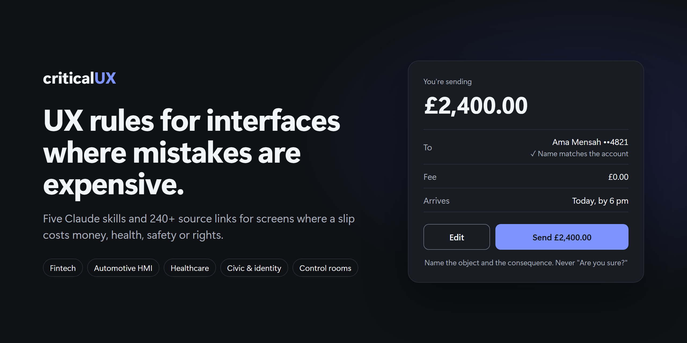

<p align="center">
  
</p>

<p align="center">
  <a href="https://github.com/Sthitapragna-009/Critical_UX/releases/latest"></a>
  <a href="LICENSE"></a>
  <a href="LICENSE-docs"></a>
  
  <a href="https://github.com/Sthitapragna-009/Critical_UX/stargazers"></a>
</p>

# criticalUX

**Design rules for products where a slip costs money, health, safety or rights, packaged as Claude skills.**

Ask Claude to design a payment flow, a loan offer or a medication screen, and it usually gives you the happy path, an "Are you sure?" dialog and a green success tick. criticalUX teaches Claude the human-factors rules, regulations and case studies that teams in fintech, healthcare and government learned the hard way. Every rule links its source and says what kind of evidence backs it.

**Made for** product designers, UX writers, design leads and researchers working on banking, payments, lending, checkout, B2B finance, clinical tools, government services, identity and control rooms.

## What changes in practice

| You ask for… | Typical result | With criticalUX |
|---|---|---|
| A confirm step before a transfer | "Are you sure?" with Yes / No | Names the payee, amount, fee and arrival time; the button says **Send £2,400.00**; the payee-name check is shown, by market (UK CoP, EU VoP) |
| A portfolio chart | Green up, red down, axis cropped to look dramatic | Gain/loss colour by market (red-up in China, Japan, Taiwan), sign and glyph as well as colour, honest baseline, fan chart for projections |
| Copy for a declined card | "Transaction failed. Error 51." | Plain reason, what happens to the money, the next step, calm tone, no blame |
| A warning for a risky payment | The same warning every time | Risk-targeted friction, the safe action as the main button, warnings that change form so people keep reading them |

These are examples of the rules in the skills, not recorded outputs. Try them yourself with the [prompt gallery](docs/prompts.md).

## Get started

### Option 1: Claude.ai or the Claude desktop app (no code)

1. Download the skills you need. Always include **critical-core**; the others build on it.

   | Skill | Download |
   |---|---|
   | critical-core (start here) | [critical-core.zip](https://github.com/Sthitapragna-009/Critical_UX/releases/latest/download/critical-core.zip) |
   | money-data | [money-data.zip](https://github.com/Sthitapragna-009/Critical_UX/releases/latest/download/money-data.zip) |
   | money-flows | [money-flows.zip](https://github.com/Sthitapragna-009/Critical_UX/releases/latest/download/money-flows.zip) |
   | critical-domains | [critical-domains.zip](https://github.com/Sthitapragna-009/Critical_UX/releases/latest/download/critical-domains.zip) |

2. In Claude, open **Settings → Capabilities → Skills** and upload each zip as it is. Don't unzip it.
3. Start a new chat and ask: *"Design a send-money flow for a UK and EU neobank."*

### Option 2: Claude Code

Type these in Claude Code (they're Claude Code commands, not terminal commands):

```text
/plugin marketplace add Sthitapragna-009/Critical_UX
/plugin install critical-ux@criticalux
```

### Option 3: Just the tokens

Use the colour, type, spacing and motion tokens without Claude:

- **Figma:** import [`tokens/figma/light.tokens.json`](tokens/figma/light.tokens.json) and [`dark.tokens.json`](tokens/figma/dark.tokens.json) with Tokens Studio or another plugin that reads the W3C design-tokens format, one file per mode.
- **Web:** link [`tokens/criticalux.css`](tokens/criticalux.css).

```html
<link rel="stylesheet" href="tokens/criticalux.css">
<body data-theme="dark" data-market="red-up">
  <p class="cx-amount">¥12,480</p>
  <p class="cx-num cx-delta--up">+¥320 (+2.6%) today</p>
  <span class="cx-status cx-status--pending">◐ Pending</span>
</body>
```

Every text and border colour passes WCAG 2.2 AA in both themes. Market modes swap gain/loss colours for red-up markets or colour-blind users, and privacy mode blurs balances.

## Prompts to try

- *"Audit this checkout for dark patterns in India."*
- *"Write the copy for a declined card payment."*
- *"Which chart should show a retirement projection?"*
- *"Design a medication order screen that prevents dose-notation errors."*
- *"Do a UX-law audit of these three payment apps and compare them task by task."*

For better answers, tell Claude the **market**, **who uses it**, **what can go wrong** and **what you want back**. More in the [prompt gallery](docs/prompts.md).

## What's inside

| Skill | Use it for |
|---|---|
| `critical-core` | Start here. Risk-control hierarchy, confirmations that don't habituate, evidence-backed friction, undo, alert tiers and budgets, mode and status visibility, failing visibly, emotion and tone of voice, celebration and nudge ethics, vulnerability, inclusion (WCAG 2.2, European Accessibility Act), visual language, AI trust, UX laws for fintech (Fitts, Hick, Jakob, peak-end, defaults, anchoring…) and how to audit with them, audit procedure |
| `money-data` | Currency formatting, tabular figures, masking, gain/loss colour by market, chart chooser, honest axes, fan charts for projections, accessible scrubbing, payment and transfer status, records, statements, B2B dashboards and data grids |
| `money-flows` | Amount entry, FX and fee quotes, payee verification (UK CoP, EU VoP, Australia), review screens, scam warnings, decline copy, disputes, KYC, passkeys, SCA/3DS, consent, credit and BNPL disclosure, a dark-pattern catalogue, B2B/B2C/B2B2C/D2C models, POS, ATMs, QR, USSD, wallets, notifications, AI-agent payments, rules for the UK, EU, US, India, Brazil, Singapore, Australia and more, and case studies (Wise, Monzo, Apple Card, Google Pay/Tez, PhonePe, Stripe, Nubank, Robinhood, M-Pesa…) |
| `critical-domains` | Healthcare (dose notation, EHR use errors, alert fatigue, FDA/IEC 62366-1 validation, risk communication), civic services (GOV.UK, USWDS, question pages), digital identity (NIST 800-63-4, EU wallet), control rooms and fleet operations (ISA-101, alarm budgets, dark cockpit, situation awareness) |

Plus `tokens/` (original, contrast-checked semantic tokens in JSON, CSS and Figma formats), `scripts/` (contrast and token checks) and [`figma-plugin/`](figma-plugin/README.md): audit a Figma frame against these rules, add markers to the canvas, insert safe patterns and browse every rule, with an optional deep review by Claude.

**Designing for cars, motorcycles or scooters?** The automotive skill now lives in its own repo: [automotive-hmi-ux](https://github.com/Sthitapragna-009/automotive-hmi-ux).

## The ten rules

1. Design the hazard out, then guard it, then inform. Warnings are the second-weakest control.
2. Confirm the specific object and consequence, never "Are you sure?".
3. Friction only where risk is, with the safe action as the prominent button.
4. Interruptions are scarce: tier them, budget them, vary repeated warnings.
5. Quiet when normal; colour means attention.
6. Mode, environment and who is in control are always visible. Fail visibly.
7. The total is the most prominent number. Fees are named. Nothing is pre-ticked.
8. Calm by default; celebrate only the person's own wins.
9. Design for the most constrained user and channel you serve.
10. Every rule has a source, a tag and, where it changes, a date.

## How rules are sourced

Every rule carries one of these tags, so you know how much weight it can bear:

| Tag | Meaning |
|---|---|
| `[REG]` | Law, regulation or formal standard |
| `[STD]` | Platform or industry guideline, rating protocol |
| `[RES]` | Published research |
| `[PRAC]` | Documented company practice |
| `[INF]` | criticalUX inference from the sources |

The skills come from two deep-research passes (November 2026) covering 30+ regulators and standards bodies, peer-reviewed studies on scam warnings, habituation, forecasts and risk communication, and the published design work of more than 25 companies. Each reference file ends with an honest list of gaps.

## Help make it better

- **Spotted a wrong or outdated rule?** [Report it](https://github.com/Sthitapragna-009/Critical_UX/issues/new?template=fix-a-rule.yml).
- **Know a rule, study or market we're missing?** [Suggest it](https://github.com/Sthitapragna-009/Critical_UX/issues/new?template=suggest-a-rule.yml). The most wanted gaps are in [CONTRIBUTING.md](CONTRIBUTING.md).
- **Found it useful?** A ⭐ helps other designers find it.

Related:

- [automotive-hmi-ux](https://github.com/Sthitapragna-009/automotive-hmi-ux): the same approach for car, motorcycle and scooter interfaces.
- [liqUI9](https://github.com/Sthitapragna-009/liqUI9): Liquid Glass and Apple HIG as Claude skills.

## Credits and licence

Created by **[KSP](https://kspportfolio-one.vercel.app)**.

- Code (`tokens/`, `scripts/`, code samples): [MIT](LICENSE)
- Written guidance (skills, references, docs): [CC BY 4.0](LICENSE-docs)

criticalUX is an independent community project and design guidance, not legal, medical or engineering advice. It summarises and links to regulations, standards and company publications in its own words. See [NOTICE.md](NOTICE.md) for trademarks and third-party systems.
